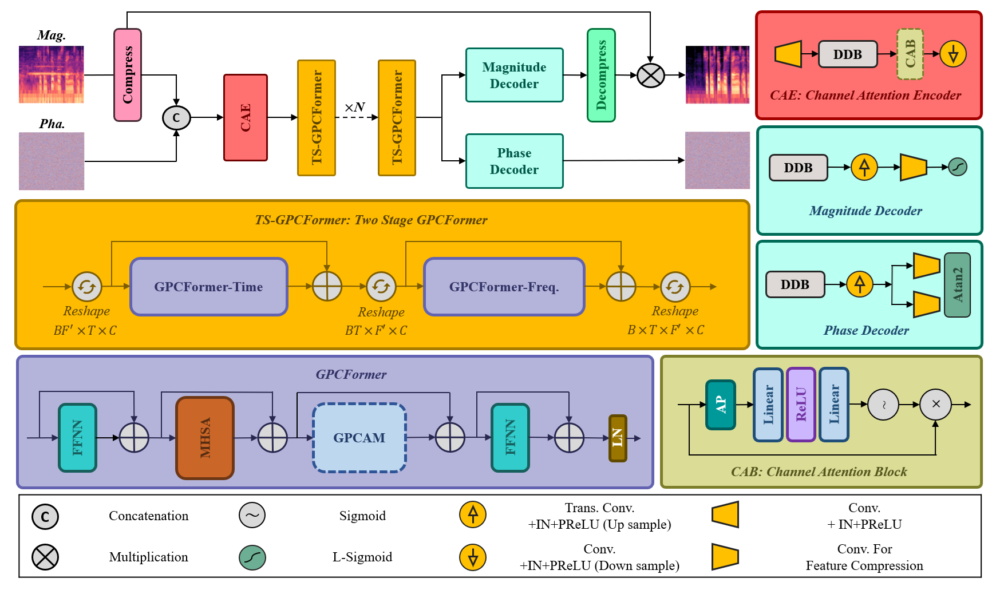
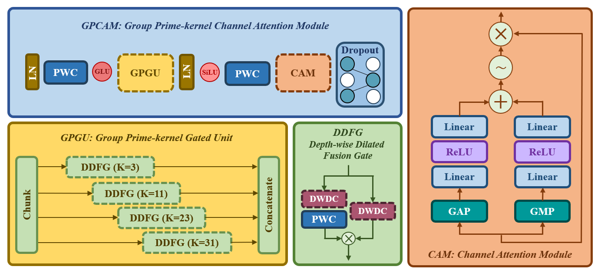

# GSE-Net: Multi-Scale Feature Extraction for Single-Channel Speech Enhancement.
### Alireza KayedNezami, Rahil Mahdian Toroghi, Hassan Zareian
**Official implementation of GSE-Net, accepted at ICEE 2026.**

**Abstract:** Single-channel speech enhancement remains a central challenge in signal processing, where the goal is to recover clean speech from signals contaminated by environmental noise. Although CNN–Transformer hybrids have shown strong performance, the field still requires models capable of capturing complex time–frequency dependencies and extracting multiscale representations. This paper introduces GSE-Net, a deep hybrid architecture that combines the local feature modeling capabilities of convolutional networks with the long-range dependency modeling of attention-based modules. This design strengthens the model’s capacity to jointly capture global and local structures. Experimental evaluations on the VoiceBank+DEMAND dataset show that GSE-Net delivers results that are comparable to, and in many cases surpass, leading state-of-the-art methods. The model maintains high speech intelligibility and significantly enhances perceptual quality, effectively advancing single-channel speech enhancement toward near-clean speech reconstruction.

## Note
Pre-trained model weights are not provided. The model can be trained from scratch using the provided source code.

## Pre-requisites

## Training

## Inference

## Model Structure

  The overall architecture of the GSE-Net and GPCFormer, Encoder and Decoder Structural Details.
  

  Structural details of GPCAM, GPGU, CAM & DDFG in GSE-Net.
  

## Comparison with other SE models

  

## Acknowledgements 
We referred to [PrimeK-Net](https://github.com/huaidanquede/PrimeK-Net), [CBAM](https://github.com/Peachypie98/CBAM) and [CMGAN](https://github.com/ruizhecao96/CMGAN) to implement this.

## Citation
